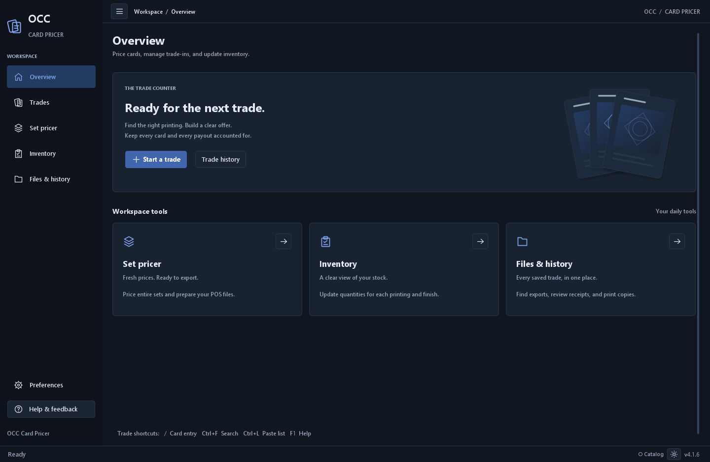
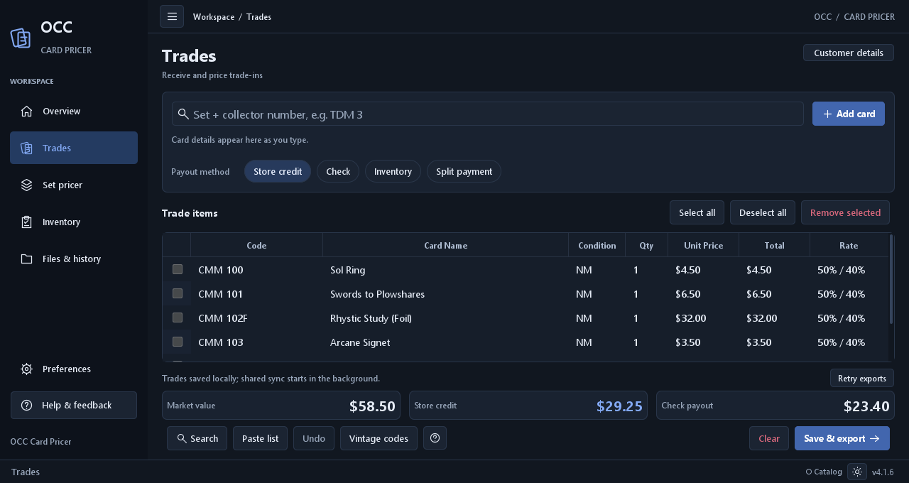

# OCC Card Pricer

A desktop application for Magic: The Gathering card trading, pricing, inventory management, and trade history. Built for card shops and trading businesses that need reliable pricing, POS integration, and multi-workstation synchronization.



## Features

- **Card Pricing** — Look up any MTG card by name or set/collector code against the Scryfall catalog (106k+ printings). Condition-adjusted pricing with configurable buy-rate tiers and bounties.
- **Trade Management** — Build trades with real-time totals, split tender (credit/check), and automatic receipt and CSV generation. Draft auto-save with multi-draft support.
- **Inventory Tracking** — Load entire sets, track normal/foil/etched quantities, and export to POS-compatible formats.
- **Trade History** — SQLite-backed history with full-text search, pagination, revision tracking, and receipt archival.
- **Multi-Workstation Sync** — Share trades, buy rates, and POS status across computers via a network folder. File locking, conflict resolution, and offline-first operation.
- **POS Integration** — 19-column receiving CSV export, quantity exports, and promo-to-base-set code mapping for seamless POS import.
- **Set Pricer** — Bulk pricing for entire sets with daily Scryfall set discovery.



## Requirements

- **JDK 25** with `JAVA_HOME` set
- **Maven 3.9.16+** (included via Maven Wrapper)

## Quick Start

```bash
# Build and run tests
./mvnw clean verify        # macOS/Linux
.\mvnw.cmd clean verify    # Windows

# Package for distribution
bash ./build.sh             # macOS
.\build.ps1                 # Windows

# Run the application
java -Xmx512m --enable-native-access=ALL-UNNAMED -jar target/OCC_Trade_Pricer.jar
```

Tests use in-memory preferences, temporary files, and synthetic data. No external services are contacted during testing.

## Data Storage

| Platform | Location |
|---|---|
| Windows | `%APPDATA%\OCC_Trade_Pricer` |
| macOS/Linux | `~/.occ_trade_pricer` |

Override with `-Dcardpricer.dataDir=/path` for isolated verification.

## Documentation

| Document | Description |
|---|---|
| [Operations Guide](docs/OPERATIONS.md) | Detailed trade, storage, sync, and export behavior |
| [POS Schema](docs/POS_SCHEMA.md) | 19-column receiving CSV specification |
| [Desktop Scalability](docs/DESKTOP_SCALABILITY.md) | Performance benchmarks (10k trades, 100k history) |
| [UI Refresh](docs/UI_REFRESH.md) | Interface design notes |
| [Third-Party Notices](THIRD_PARTY_NOTICES.md) | Dependency licenses |
| [Changelog](src/changelog.txt) | Version history |

## Tech Stack

| Component | Version |
|---|---|
| Java | 25 |
| UI | Swing + [FlatLaf](https://github.com/JFormDesigner/FlatLaf) 3.7 |
| Database | [SQLite JDBC](https://github.com/xerial/sqlite-jdbc) 3.53.2.0 |
| CSV | [Apache Commons CSV](https://commons.apache.org/proper/commons-csv/) 1.14.1 |
| JSON | [JSON-java](https://github.com/stleary/JSON-java) 20231013 |
| Build | Maven with Shade Plugin (single executable JAR) |
| Testing | JUnit Jupiter 6.1.3 |

## Contributing

See [CONTRIBUTING.md](CONTRIBUTING.md) for guidelines on reporting issues and submitting changes.

## Security

See [SECURITY.md](SECURITY.md) for the security policy and how to report vulnerabilities.

## License

Copyright 2026 OCC Card Pricer Contributors

Licensed under the Apache License, Version 2.0. See [LICENSE](LICENSE) for the full text.
